# OpenTDF NiFi
Integration of the [OpenTDF Platform](https://github.com/opentdf/platform) into [NiFi](https://nifi.apache.org/)

Components:
* "Zero Trust Data Format" (ZTDF) Processors: 
  * [ConvertToZTDF](./nifi-tdf-processors/src/main/java/io/opentdf/nifi/ConvertToZTDF.java): A NiFi processor that converts FlowFile content to ZTDF format. 
  * [ConvertFromZTDF](./nifi-tdf-processors/src/main/java/io/opentdf/nifi/ConvertFromZTDF.java): A NiFi processor that converts ZTDF formatted FlowFile content to its plaintext representation

* Controller Services:
  * [OpenTDFControllerService](./nifi-tdf-controller-services-api/src/main/java/io/opentdf/nifi/OpenTDFControllerService.java): A NiFi controller service providing OpenTDF Platform Configuration

## Using a custom TrustStore
Communicating over TLS with self-signed or other untrusted certs can be configured using NiFi's standard [SSL Context Service](https://nifi.apache.org/docs/nifi-docs/components/org.apache.nifi/nifi-ssl-context-service-nar/1.25.0/org.apache.nifi.ssl.StandardSSLContextService/index.html)
and then wired into the processors by setting their respective SSL Context Service properties to use a configured
SSL Context Service.

## Example

To use these processors in NiFi:
* Configure the OpenTDFControllerService properties
  * set then OpenTDF compliant endpoint
  * set OIDC Client credentials (client id and client secret)
  * set the data policy (UpdateAttribute Processor)
  * set the KAS URL: ConvertToZTDF processor

#### FlowChart: Generic ZTDF Nifi Flows




# Quick Start - Docker Compose

1. Build the NiFi Archives (NARs) and place in the docker compose mounted volumes. The opentd
   java-sdk is currently hosted on github's maven package repository, so github credentials are required to perform a maven build.

    ```shell
    export GITHUB_ACTOR=your gh username
    export GITHUB_TOKEN=your gh token
    make compose-package
    ```
1. Build local Nifi Image

    ```shell
    make nifi-image
    ```

1. Start docker compose
    ```shell
    docker compose up
    ```
1. [Log into NiFi](http://localhost:18080/nifi)

## Java4Shell (CVE-2026-114938)

[Java4Shell](https://calif.io/java4shell) affects the JVM's optimized Base64
decoder on x86-64 CPUs with AVX-512 VBMI support. Updating these processors' NARs
or changing Maven's Java compilation target does not patch the JVM running NiFi.

`make nifi-image` pulls the base runtime image and wraps the upstream NiFi image
with `JAVA_TOOL_OPTIONS=-XX:-UseBASE64Intrinsics`. This disables the vulnerable
intrinsic for both NiFi and other Java processes in the container. It is a
mitigation, not a patched JRE, and may reduce Base64 throughput. Do not run the
intermediate `opentdf-nifi:base` image directly or override `JAVA_TOOL_OPTIONS`
without retaining this flag.

Rebuild and recreate existing Compose containers to apply the mitigation:

```shell
make nifi-image
docker compose up -d --force-recreate
docker compose exec opentdf-nifi java -XX:+PrintFlagsFinal -version 2>&1 | grep UseBASE64Intrinsics
```

The flag must report `false`. Recreating containers restarts NiFi; schedule this
for an appropriate maintenance window. Existing containers are not updated by
rebuilding the image alone.

For NiFi deployed outside this Compose setup, upgrade the **NiFi host's Java
runtime** to a vendor-confirmed patched release. Temurin has published
[17.0.21.1+2](https://github.com/adoptium/temurin17-binaries/releases/tag/jdk-17.0.21.1%2B2)
and
[21.0.13.1+2](https://github.com/adoptium/temurin21-binaries/releases/tag/jdk-21.0.13.1%2B2);
CI uses the latter. Until the host runtime is patched, add
`-XX:-UseBASE64Intrinsics` as an unused `java.arg.<number>` entry in NiFi's
`conf/bootstrap.conf`, then restart NiFi. Verify the running NiFi JVM's flags,
not only the default `java` executable. For example, if the matching JDK's
`jcmd` is installed, run `jcmd <nifi-java-pid> VM.flags -all` as the NiFi user
and confirm `UseBASE64Intrinsics = false`. A clean check on an ARM64 development
machine does not prove an x86-64 deployment is patched.
